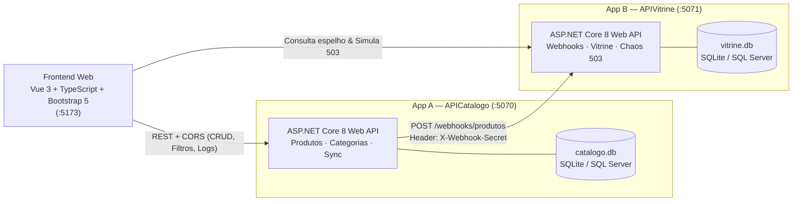

# Catálogo Master & Sincronização entre Aplicações

Sistema full-stack de **cadastro, consulta e sincronização de produtos entre duas aplicações independentes**, desenvolvido com **ASP.NET Core 8 (C#)**, **Entity Framework Core** (SQLite por padrão + suporte configurável para SQL Server), **Vue 3 + TypeScript + Bootstrap 5** e integração via **Webhook HTTP autenticado**.

> Projeto evoluído a partir de uma API inicial de catálogo para demonstrar arquitetura full-stack prática, resiliência em integrações HTTP entre serviços e persistência relacional pronta para rodar localmente com zero configuração externa.

---

## Arquitetura da Solução



### Fluxo de Sincronização
1. O usuário cadastra, edita ou exclui um produto no **Frontend Vue** (consumindo o `APICatalogo`).
2. O `APICatalogo` valida os dados (Data Annotations + validação customizada), persiste no seu banco (`catalogo.db`) e dispara um **Webhook HTTP** autenticado com `X-Webhook-Secret` para a `APIVitrine`.
3. A `APIVitrine` valida o secret e faz **upsert** (ou remoção) idempotente pelo `ProdutoOrigemId` no seu próprio banco (`vitrine.db`).
4. O `APICatalogo` registra o resultado na tabela `SyncLogs` (ação, status HTTP, latência em `ms` e eventual erro). **Se a `APIVitrine` estiver offline ou retornando `503`, o cadastro principal não falha** — a divergência aparece no painel comparativo e pode ser ressincronizada com um clique.

---

## Stack Tecnológica

| Camada | Tecnologias |
| :--- | :--- |
| **App A (`APICatalogo`)** | .NET 8, ASP.NET Core Web API, EF Core 8 (SQLite / SQL Server), Swagger/OpenAPI, `IHttpClientFactory` |
| **App B (`APIVitrine`)** | .NET 8, ASP.NET Core Web API, EF Core 8 (SQLite / SQL Server), Swagger/OpenAPI, simulador de falha HTTP 503 |
| **Frontend (`frontend`)** | Vue 3 (Composition API), TypeScript, Vite, Bootstrap 5, Bootstrap Icons, Axios |
| **Banco de Dados** | **SQLite** como padrão (criação e seed automáticos ao iniciar) com alternância para **SQL Server** via `appsettings.json` |

---

## Estrutura do Repositório

```text
APICatalogo/
├── APICatalogo.slnx              # Solução .NET contendo as duas APIs
├── start-all.ps1                 # Script PowerShell para subir os 3 serviços juntos
├── APICatalogo/                  # App A — API Principal (Catálogo Master)
│   ├── Context/                  # AppDbContext + DbInitializer (seed automático)
│   ├── Controllers/              # ProdutosController, CategoriasController, SyncController
│   ├── DTOs/                     # Contratos de entrada/saída, paginação e webhook
│   ├── Extensions/               # Middleware global de tratamento de exceções
│   ├── Models/                   # Produto, Categoria, SyncLog, ErrorDetails
│   ├── Services/                 # WebhookSyncService (+ IMeuServico preservado)
│   └── Validations/              # Validações customizadas
├── APIVitrine/                   # App B — API Secundária (Vitrine / PDV)
│   ├── Context/                  # VitrineDbContext (banco isolado)
│   ├── Controllers/              # WebhooksController, VitrineController
│   ├── DTOs/                     # Contratos do webhook e simulação de falha
│   ├── Models/                   # ProdutoVitrine
│   └── Services/                 # ChaosSimulationState (modo 503 ao vivo)
└── frontend/                     # Interface Web em Vue 3 + TypeScript + Bootstrap 5
    └── src/
        ├── components/           # ProdutosView, ProdutoModal, CategoriasView, SincronizacaoView
        ├── services/             # Cliente Axios para App A (:5070) e App B (:5071)
        ├── types/                # Interfaces TypeScript espelhando os DTOs das APIs
        └── utils/                # Formatadores de moeda e data/hora
```

---

## Como Executar o Projeto

### Pré-requisitos
- [.NET 8 SDK](https://dotnet.microsoft.com/download/dotnet/8.0) (ou superior, ex.: .NET 10 SDK)
- [Node.js 20+](https://nodejs.org/) e `npm`

> Não é necessário instalar nem configurar servidor de banco de dados: os bancos SQLite (`catalogo.db` e `vitrine.db`) e os dados iniciais são criados automaticamente na primeira execução.

### Opção 1 — Subir tudo de uma vez (Windows PowerShell)
Na raiz do repositório:
```powershell
cd frontend
npm install
cd ..
.\start-all.ps1
```

### Opção 2 — Subir manualmente em 3 terminais

**Terminal 1 — App A (`APICatalogo` em `http://localhost:5070`):**
```bash
cd APICatalogo
dotnet run --launch-profile http
```

**Terminal 2 — App B (`APIVitrine` em `http://localhost:5071`):**
```bash
cd APIVitrine
dotnet run --launch-profile http
```

**Terminal 3 — Frontend Vue (`http://localhost:5173`):**
```bash
cd frontend
npm install
npm run dev
```

### URLs Principais
- **Interface Web (Vue + Bootstrap)**: `http://localhost:5173`
- **Swagger — APICatalogo (App A)**: `http://localhost:5070/swagger`
- **Swagger — APIVitrine (App B)**: `http://localhost:5071/swagger`

---

## Alternando para SQL Server

Ambos os projetos (`APICatalogo` e `APIVitrine`) suportam troca de provedor sem alterar código C#. Basta editar o `appsettings.json` correspondente:

```json
{
  "DatabaseProvider": "SqlServer",
  "ConnectionStrings": {
    "SqlServerConnection": "Server=(localdb)\\mssqllocaldb;Database=CatalogoDB;Trusted_Connection=True;TrustServerCertificate=True;"
  }
}
```

---

## Principais Endpoints

### App A — `APICatalogo` (`:5070`)
| Método | Rota | Descrição |
| :--- | :--- | :--- |
| `GET` | `/Produtos` | Consulta paginada com `search`, `categoriaId`, `precoMin`, `precoMax`, `sortBy`, `sortDir`, `page`, `pageSize` |
| `GET` | `/Produtos/{id}` | Detalhes de um produto |
| `POST` | `/Produtos` | Cria produto, valida regras de domínio e dispara webhook `CREATED` |
| `PUT` | `/Produtos/{id}` | Atualiza produto e dispara webhook `UPDATED` |
| `DELETE` | `/Produtos/{id}` | Remove produto e dispara webhook `DELETED` |
| `GET/POST/PUT/DELETE` | `/Categorias` | CRUD completo de categorias (com proteção HTTP `409 Conflict` se houver produtos vinculados) |
| `GET` | `/Sync/logs` | Histórico de webhooks com contagem de sucessos/falhas e latência média |
| `POST` | `/Sync/produtos/{id}` | Ressincroniza um produto específico com a `APIVitrine` |
| `POST` | `/Sync/reconciliar` | Envia todo o catálogo para a `APIVitrine` e remove registros órfãos |
| `GET` | `/health` | Saúde da API, provedor de banco e totais |

### App B — `APIVitrine` (`:5071`)
| Método | Rota | Descrição |
| :--- | :--- | :--- |
| `POST` | `/webhooks/produtos` | Recebe evento `UPSERT` ou `DELETE` validando `X-Webhook-Secret` |
| `POST` | `/webhooks/reconciliar` | Reconcilia o espelho completo da vitrine |
| `GET` | `/vitrine/produtos` | Lista os produtos atualmente replicados no banco `vitrine.db` |
| `GET` | `/vitrine/status` | Saúde da réplica e estado da simulação de falha |
| `POST` | `/vitrine/simular-falha` | Ativa/desativa retorno `HTTP 503` nos webhooks para demonstração ao vivo |

---

## Roteiro de Demonstração (e Pontos para Entrevista)

Use este roteiro de 2 minutos para apresentar o projeto em entrevistas técnicas:

1. **Cadastro e consulta**: filtre produtos por texto/categoria/preço na aba **Produtos** e tente cadastrar um produto com a primeira letra minúscula para mostrar a validação customizada da API (`IValidatableObject`) refletida no formulário Vue.
2. **Sincronização automática**: cadastre ou edite um produto válido e abra a aba **Sincronização** — mostre o registro idêntico nos dois bancos (`catalogo.db` e `vitrine.db`) e o log do webhook com status `HTTP 200` e latência em milissegundos.
3. **Simulação de falha e recuperação**: clique em **Simular falha (HTTP 503)** na `APIVitrine`, edite o preço de um produto e mostre que:
   - o `APICatalogo` não quebrou o cadastro do usuário;
   - o erro `503` ficou auditado no histórico de webhooks (`SyncLogs`);
   - o comparativo lado a lado destacou automaticamente o item como **Divergente**.
4. **Ressincronização**: clique em **Restaurar APIVitrine** e depois em **Ressincronizar** (ou **Sincronizar catálogo inteiro**) para devolver os dois bancos a 100% de consistência.

### Decisões técnicas fáceis de defender na entrevista
- **Por que DTOs em vez de expor as entidades diretamente?** Evita *over-posting*, desacopla o contrato da API do esquema de banco e elimina ciclos de serialização.
- **Por que a `APIVitrine` tem banco próprio?** Em arquiteturas distribuídas, cada serviço é dono dos seus dados (*Database per Service*), comunicando-se via contrato HTTP/Webhook em vez de compartilhar tabelas diretamente.
- **Por que `IHttpClientFactory` no envio do webhook?** Evita exaustão de sockets (`SocketException`) gerenciando o pool de conexões HTTP corretamente no ASP.NET Core.
- **Como funciona a idempotência no destino?** A `APIVitrine` usa `ProdutoOrigemId` como chave primária sem auto-incremento; reenviar o mesmo webhook várias vezes sempre converge para o mesmo estado sem duplicar registros.
- **Próximo passo natural em escala de produção**: trocar o webhook síncrono pelo **Outbox Pattern + Worker/Mensageria (RabbitMQ/Azure Service Bus)** com retries automáticos e backoff exponencial.

---

## Autor

Desenvolvido por **[Bernardo Fernando](https://github.com/BernardoFM1)**.
