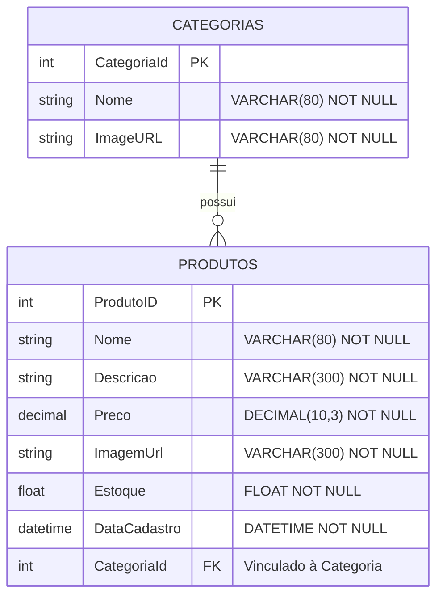

# 📦 Catálogo de Produtos e Categorias - ASP.NET Core Web API

Uma API RESTful moderna e robusta desenvolvida em **.NET 8** e **C#**, com foco no gerenciamento completo de catálogo de produtos e suas respectivas categorias (e.g., lanches, bebidas, sobremesas). O projeto utiliza **Entity Framework Core** com provedor **Pomelo MySQL**, arquitetura em camadas clara, persistência relacional com migrações (*Code-First*), seed de dados e documentação interativa via **Swagger/OpenAPI**.

---

## 📑 Sumário

- [Visão Geral e Contexto](#-visão-geral-e-contexto)
- [Tecnologias e Bibliotecas](#-tecnologias-e-bibliotecas)
- [Arquitetura do Projeto](#-arquitetura-do-projeto)
- [Modelo de Dados](#-modelo-de-dados)
- [Endpoints da API](#-endpoints-da-api)
  - [Categorias](#-categorias-controller)
  - [Produtos](#-produtos-controller)
- [Como Executar o Projeto](#-como-executar-o-projeto)
  - [Pré-requisitos](#pré-requisitos)
  - [Passo a Passo](#passo-a-passo)
- [Migrações e Dados Iniciais (Seed)](#-migrações-e-dados-iniciais-seed)
- [Testes de Requisição](#-testes-de-requisição)
- [Boas Práticas Implementadas](#-boas-práticas-implementadas)

---

## 🎯 Visão Geral e Contexto

O objetivo principal desta API é fornecer os serviços essenciais de *backend* (CRUD completo) para sistemas de comércio, catálogo eletrônico ou cardápio digital:
- **Gestão de Categorias:** Organização hierárquica dos itens (ex.: Lanches, Bebidas, Sobremesas).
- **Gestão de Produtos:** Controle de estoque, preço unitário, imagens ilustrativas, descrições detalhadas e vínculo com categorias.
- **Relacionamento 1:N:** Cada categoria pode possuir múltiplos produtos associados, mantendo integridade referencial.
- **Otimização de Consultas:** Uso de consultas não rastreadas (`AsNoTracking()`) em leituras para ganho de performance e menor consumo de memória.
- **Resolução de Ciclos de Referência:** Configuração de serialização JSON com `ReferenceHandler.IgnoreCycles` para evitar loops infinitos de navegação mútua entre entidades.

---

## 🛠 Tecnologias e Bibliotecas

| Tecnologia / Pacote | Versão | Função no Projeto |
| :--- | :--- | :--- |
| **.NET** | `8.0` | Framework principal de desenvolvimento |
| **C#** | `12` | Linguagem de programação orientada a objetos |
| **ASP.NET Core Web API** | `8.0` | Framework web para criação de serviços RESTful |
| **Entity Framework Core** | `8.0.x` | ORM para mapeamento objeto-relacional e manipulação do banco |
| **Pomelo.EntityFrameworkCore.MySql** | `8.0.3` | Provedor MySQL para Entity Framework Core |
| **Microsoft.EntityFrameworkCore.Design** | `8.0.x` | Ferramental de design para suporte a Migrations via CLI |
| **Swashbuckle.AspNetCore (Swagger)** | `6.6.2` | Geração de documentação OpenAPI e interface Swagger UI |
| **MySQL** | `8.x` | Sistema gerenciador de banco de dados relacional |

---

## 🏗 Arquitetura do Projeto

A aplicação está organizada de forma modular e coesa:

```text
APICatalogo/
├── APICatalogo.slnx                  # Arquivo de Solução .NET
├── .gitignore                         # Regras de exclusão do Git para .NET e VS
├── README.md                          # Documentação detalhada da API
└── APICatalogo/                       # Projeto Web API principal
    ├── Context/
    │   └── AppDbContext.cs           # Contexto do EF Core (DbSets e Mapeamento)
    ├── Controllers/
    │   ├── CategoriasController.cs   # Endpoints de gerenciamento de Categorias
    │   └── ProdutosController.cs     # Endpoints de gerenciamento de Produtos
    ├── Models/
    │   ├── Categoria.cs              # Entidade Categoria com Data Annotations
    │   └── Produto.cs                # Entidade Produto com Data Annotations
    ├── Migrations/                   # Histórico de migrações e seeds do banco de dados
    │   ├── PrimeiraMigrate.cs
    │   ├── AjusteTabelas.cs
    │   ├── Populacategorias.cs
    │   └── populaProdutos.cs
    ├── Properties/
    │   └── launchSettings.json       # Configurações de inicialização local
    ├── appsettings.json              # Configurações gerais e Connection String
    ├── appsettings.Development.json  # Configurações do ambiente de desenvolvimento
    ├── APICatalogo.http              # Arquivo de testes rápidos de requisições HTTP
    └── Program.cs                    # Configuração de serviços, DI e pipeline HTTP
```

---

## 🗄 Modelo de Dados

O modelo relacional do projeto é composto por duas entidades principais com relacionamento **1 para N** (1 Categoria possui N Produtos):



---

## 🚀 Endpoints da API

A documentação visual e interativa dos endpoints está disponível no Swagger UI ao iniciar o projeto (`/swagger`).

### 📂 Categorias Controller (`/Categorias`)

| Método | Rota | Descrição | Status Retornado |
| :--- | :--- | :--- | :--- |
| `GET` | `/Categorias` | Retorna a lista de todas as categorias cadastradas | `200 OK`, `500 Internal Server Error` |
| `GET` | `/Categorias/{id}` | Busca os dados de uma categoria por ID | `200 OK`, `404 Not Found` |
| `POST` | `/Categorias` | Cadastra uma nova categoria no banco | `201 Created`, `400 Bad Request` |
| `PUT` | `/Categorias/{id}` | Altera as informações de uma categoria existente | `200 OK`, `400 Bad Request` |
| `DELETE` | `/Categorias/{id}` | Exclui uma categoria do banco | `200 OK`, `400 Bad Request` |

#### Exemplo de Payload para Cadastro de Categoria (`POST /Categorias`):
```json
{
  "nome": "Lanches Artesanais",
  "imageURL": "lanches-artesanais.jpg"
}
```

---

### 🍔 Produtos Controller (`/Produtos`)

| Método | Rota | Descrição | Status Retornado |
| :--- | :--- | :--- | :--- |
| `GET` | `/Produtos` | Lista todos os produtos cadastrados | `200 OK`, `404 Not Found` |
| `GET` | `/Produtos/{id}` | Busca os detalhes de um produto específico | `200 OK`, `404 Not Found` |
| `POST` | `/Produtos` | Adiciona um novo produto no catálogo | `201 Created`, `400 Bad Request` |
| `PUT` | `/Produtos/{id}` | Atualiza o registro de um produto | `200 OK`, `400 Bad Request` |
| `DELETE` | `/Produtos/{id}` | Exclui um produto cadastrado | `200 OK`, `404 Not Found` |

#### Exemplo de Payload para Cadastro de Produto (`POST /Produtos`):
```json
{
  "nome": "Hambúrguer Especial",
  "descricao": "Pão brioche, blend bovino 180g e queijo cheddar",
  "preco": 28.50,
  "imagemUrl": "burger.jpg",
  "estoque": 25,
  "dataCadastro": "2026-11-06T20:00:00Z",
  "categoriaId": 2
}
```

---

## 💻 Como Executar o Projeto

### Pré-requisitos
- [.NET 8 SDK](https://dotnet.microsoft.com/download/dotnet/8.0) instalado.
- Servidor [MySQL](https://www.mysql.com/) em execução localmente ou via container Docker.
- Ferramenta de linha de comando do EF Core instalada globalmente:
  ```bash
  dotnet tool install --global dotnet-ef
  ```

### Passo a Passo

1. **Clonar o Repositório:**
   ```bash
   git clone https://github.com/BernardoFM1/API_CATALOGO.git
   cd API_CATALOGO
   ```

2. **Configurar a Conexão com o Banco de Dados:**
   Abra o arquivo [`APICatalogo/appsettings.json`](APICatalogo/appsettings.json) e configure a chave `DefaultConnection` com as credenciais do seu MySQL:
   ```json
   "ConnectionStrings": {
     "DefaultConnection": "Server=localhost;Database=CatalogoDB;Uid=seu_usuario;Pwd=sua_senha;"
   }
   ```

3. **Restaurar Dependências:**
   ```bash
   dotnet restore
   ```

4. **Aplicar as Migrações (Criação do Banco de Dados e Tabelas):**
   ```bash
   dotnet ef database update --project APICatalogo
   ```
   > Esse comando cria o banco `CatalogoDB`, as tabelas `Categorias` e `Produtos`, e executa as migrações de seed pré-configuradas.

5. **Executar a API:**
   ```bash
   dotnet run --project APICatalogo
   ```

6. **Acessar a Documentação Swagger:**
   - Swagger UI: [https://localhost:7000/swagger](https://localhost:7000/swagger) ou [http://localhost:5070/swagger](http://localhost:5070/swagger)

---

## 🌱 Migrações e Dados Iniciais (Seed)

O projeto possui migrações dedicadas para popular os primeiros dados de teste:
- **`Populacategorias`**: Insere registros de exemplo nas categorias (*Bebidas*, *Lanches*, *Sobremesas*).
- **`populaProdutos`**: Insere produtos vinculados às categorias criadas (*Coca-Cola Diet*, *Lanche de Atum*, *Pudim 100g*).

---

## 🧪 Testes de Requisição

Você pode testar a API através de:
1. **Interface do Swagger UI**: Permite testar todos os métodos de forma interativa pelo navegador.
2. **Arquivo `.http`**: Utilizando a extensão *REST Client* (VS Code) ou o editor integrado do Visual Studio, abrindo o arquivo [`APICatalogo/APICatalogo.http`](APICatalogo/APICatalogo.http).
3. **Postman / Insomnia / cURL**: Enviando requisições diretamente para as rotas mapeadas.

---

## 🛡 Boas Práticas Implementadas

- **Tratamento de Ciclos de Referência:** Prevenção de exceções `JsonException: A possible object cycle was detected` utilizando `ReferenceHandler.IgnoreCycles`.
- **Rastreamento Otimizado (`AsNoTracking`):** Utilizado em consultas somente leitura no `CategoriasController` para melhorar performance e economia de recursos.
- **Códigos de Resposta Semânticos:** Respostas adequadas segundo o protocolo HTTP (`200 OK`, `201 Created` com header `Location`, `400 Bad Request`, `404 Not Found`).
- **Validação de Entrada:** Uso de *Data Annotations* (`[Required]`, `[StringLength]`, `[Column]`, `[Key]`) para garantir integridade e validação dos dados recebidos.

---

## 👨‍💻 Autor

Desenvolvido por **[Bernardo Fernando](https://github.com/BernardoFM1)**.
